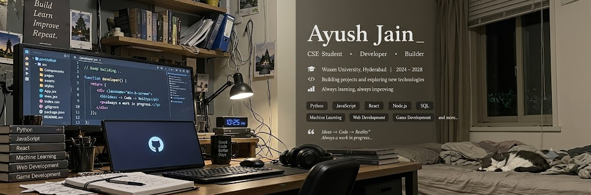
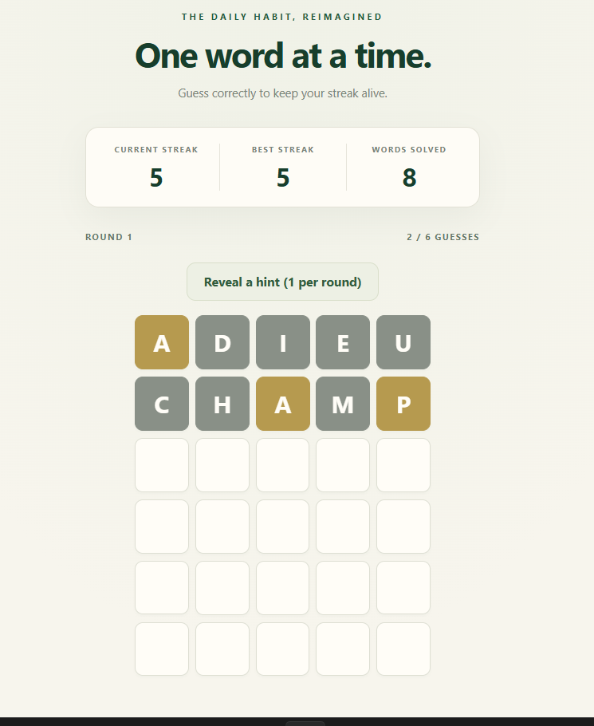
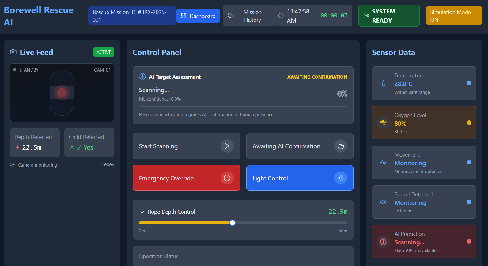
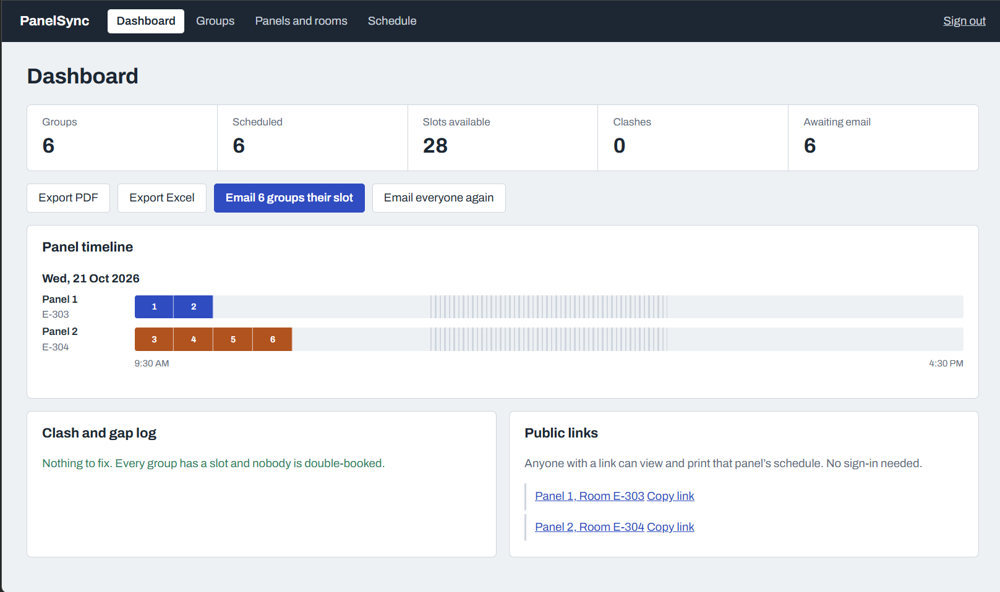

  

 

  
  

 

---

> 💡 **Currently:** Building projects, learning new technologies, and becoming a better software engineer.

---

## 👋 About Me

I'm a Computer Science Engineering student at Woxsen University, Hyderabad, 
interested in building practical software across frontend, backend, and AI/ML.

I enjoy turning ideas into working projects, ranging from from web applications and 
full-stack systems to AI-assisted and interactive applications.

Currently focused on improving my full-stack development, AI/ML, and 
software engineering skills.

---

## 🛠️ Tech Stack

<h4>Languages</h4>

  
  
  
  
  

<h4>Frontend</h4>

  
  
  

<h4>Backend</h4>

  
  
  

<h4>AI / ML</h4>

  
  
  
  

<h4>Databases</h4>

  
  
  

<h4>Tools</h4>

  
  
  

---

## 🌱 Currently Learning

- Advanced React & full-stack architecture
- Backend development & API design
- Machine Learning
- Software engineering practices

---

## 🚀 Featured Projects

### 🟩 [Word Streak](https://github.com/ayushjain510/word-streak)

  

A Wordle-inspired word-guessing game with hints, personal statistics, theme customization, authentication, and saved progress.

**React · Vite · JavaScript · Supabase**

[▶ Play Word Streak](https://word-streak.netlify.app/) · [View Source](https://github.com/ayushjain510/word-streak)

---

### 🤖 [Borewell Rescue AI](https://github.com/ayushjain510/borewell-rescue-ai)

  

An AI-assisted borewell rescue system combining sensor monitoring, machine-learning-based human detection, and a 3D robotic rescue mechanism.

**React · TypeScript · Python · Flask · scikit-learn · Blender**

[View Project](https://github.com/ayushjain510/borewell-rescue-ai)

---

### 🔐 [PanelSync](https://github.com/ayushjain510/panelsync)

  

A full-stack scheduling and notification platform for managing student groups, presentation panels, mentors, and sessions, with authentication and email notifications.

**React · Node.js · Express · MongoDB · JWT · Resend**

[View Project](https://github.com/ayushjain510/panelsync)

---

## 📊 GitHub Activity

  

---

## 🤝 Connect With Me

---

  <i>Thanks for stopping by! ⭐</i>

